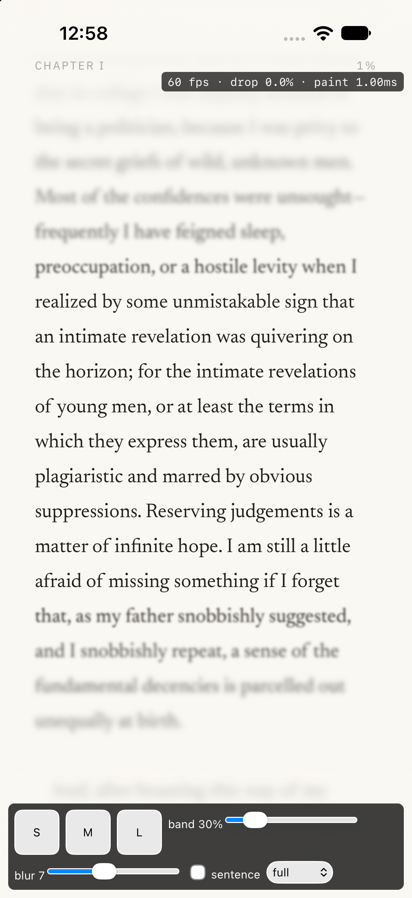

# M1 · first simulator reading (2026-09-26)

- **Device:** iPhone 18 Pro simulator, iOS 27.0 (Xcode 27.0), Mac host.
- **Build:** `npm run build:ios` (dev tools on), *The Great Gatsby*, font M, band 30%, blur 7.

| Mode | FPS while scrolling | Dropped | Paint per frame |
|---|---|---|---|
| full (per-line blur) | 60 | 0.0% | ~1.0 ms |
| fallback (static blur layers) | 60 | 0.0% | ~0.0 ms |

- **Probe:** the first-launch probe chose **fallback** on the simulator, although full mode then scrolled at 60 fps with 0% drops. The probe is probably counting start-up frames (fonts, first layout) as drops. Re-check its warm-up on a real device before trusting its decision.
- **R-07 on iOS:** after relaunching the app, it reopened at the same paragraph.
- **Caveat:** the simulator renders with the Mac GPU, so these figures are **not** evidence for R-01. R-01 has to be measured on a real mid-range iPhone (M4).

